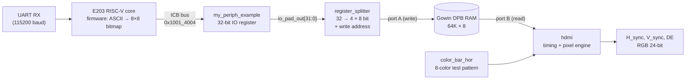
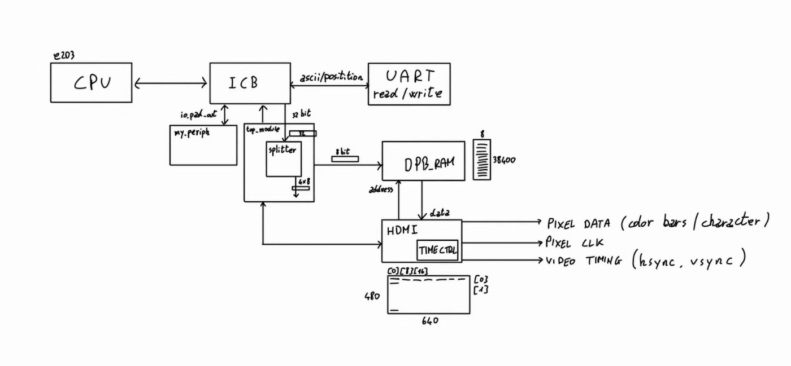
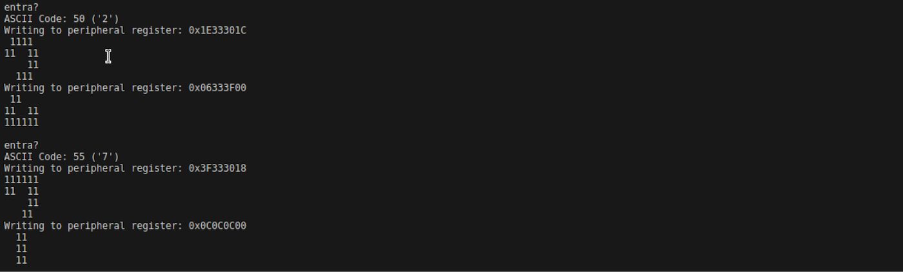
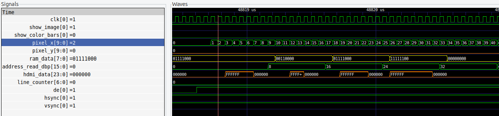
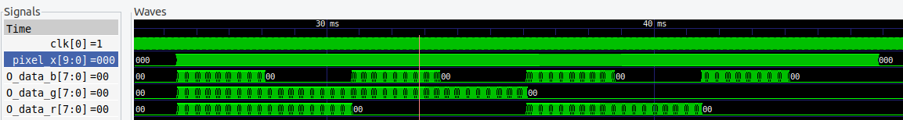

# HDMI Text Display Peripheral for the RISC-V Hummingbird E203

A memory-mapped **display peripheral** for the open-source **Hummingbird E203** RISC-V SoC, written in **Verilog**. ASCII characters arrive on the UART. The RISC-V firmware converts each one into an 8×8 bitmap and writes it over the **ICB bus** into a dual-port RAM. A video controller then draws the characters on a **640×480 @ 60 Hz** frame, after a color-bar test pattern at startup.

> Project for **Intelligent Chip and System Design**, Tongji University
> by Giorgio Giaretta and **Tommaso Magelli**.
> Full report: [`docs/HDMI_E203_Report_Giaretta_Magelli.pdf`](docs/HDMI_E203_Report_Giaretta_Magelli.pdf)

## Architecture



| Module | File | Role |
|---|---|---|
| **Firmware** | [`firmware/hello_world/src/main.c`](firmware/hello_world/src/main.c) | Polls the UART RX register, looks the character up in an 8×8 font table, packs the 8 glyph rows into two 32-bit words and writes them to the peripheral register |
| **ICB peripheral** | [`rtl/ip/my_periph_example.v`](rtl/ip/my_periph_example.v) | Memory-mapped 32-bit register on the ICB bus (base 0x1001_4000, offset 0x04) that exposes the written value on `io_pad_out` |
| **Top module** | [`rtl/ip/top_module.v`](rtl/ip/top_module.v) | Hub that connects the splitter, the dual-port RAM and the video controller |
| **Splitter** | [`rtl/ip/splitter.v`](rtl/ip/splitter.v) | Detects each new 32-bit word, splits it into 4 bytes (bit-reversed to match the scan order) and writes them to consecutive RAM addresses |
| **Video controller** | [`rtl/ip/hdmi.v`](rtl/ip/hdmi.v) | 800×525 timing counters generate hsync, vsync and DE for 640×480. It computes the RAM read address for each 8-pixel group and turns each bit of the glyph byte into a white or black 24-bit pixel |
| **Color bars** | [`rtl/ip/color_bar_hor.v`](rtl/ip/color_bar_hor.v) | Startup test pattern of 8 horizontal bands (white, yellow, cyan, green, magenta, red, blue, black) |
| **SoC integration** | [`rtl/core/`](rtl/core) | `e203_soc_demo` → `e203_soc_top` → `e203_subsys_top` → `e203_subsys_main` → `e203_subsys_perips` were modified to instantiate the peripheral and route the video signals up to the top level |

Each character takes 8 consecutive RAM bytes, one byte per glyph row. With 8-pixel-wide glyphs, a text line holds up to 80 characters (640 / 8).

Original block diagram from the report:



## Video timing (640×480 @ 60 Hz)

| | Active | Front porch | Sync | Back porch | Total |
|---|---|---|---|---|---|
| Horizontal (pixels) | 640 | 16 | 96 | 48 | 800 |
| Vertical (lines) | 480 | 10 | 2 | 33 | 525 |

## Simulation results

The full SoC is simulated with **Icarus Verilog**. The testbench ([`sim/sys_tb_top.sv`](sim/sys_tb_top.sv)) sends the characters `3A27` over UART from [`sim/input.txt`](sim/input.txt), and the waveforms are inspected in **GTKWave**.

The firmware log printed through the UART shows each character, the two 32-bit words written to the peripheral and the resulting bitmap:



Pixel output for the first line of the characters. Every 8 pixels the read address advances by 8, which moves to the next character. Each `1` bit of `ram_data` becomes a white pixel (`FFFFFF`) on `hdmi_data`:



Color-bar test pattern on the RGB channels, shown while `show_color_bars` is high:



## Repository structure

```
rtl/core/                  Hummingbird E203 SoC (5 top-level files modified for the video outputs)
rtl/ip/                    Our peripheral: my_periph_example, top_module, splitter, hdmi, color bars, Gowin DPB RAM
rtl/ip/tb/                 Unit testbenches (splitter, splitter + RAM, hdmi, top_module)
firmware/hello_world/      Firmware (main.c + E203 BSP) and makefiles; Debug/ram.hex is the prebuilt image
sim/                       System testbench, Icarus Verilog run scripts, UART input file
gowin_prj/                 Gowin EDA project and constraints (GW2A-18C, Sipeed Tang Primer 20K)
docs/                      Report and figures
```

## How to run the simulation

Requirements: **Icarus Verilog** (with `-g2005-sv`) and **GTKWave**.

1. Copy the Gowin primitive simulation library into `sim/gowin_sim_lib/prim_sim.v`. It is required by the DPB RAM model and is not redistributed here. You can find it in your Gowin EDA install under `IDE/simlib/gw2a/prim_sim.v`.
2. Run the simulation:
   ```bash
   cd sim
   ./sim_run_sys_tb.sh          # compile the SoC + peripheral with iverilog -> wave.out
   vvp -n wave.out -lxt2        # run 150 ms of simulated time (LXT2 dump, much smaller than VCD)
   gtkwave waveout.vcd          # open the dump written by the testbench
   ```
   The prebuilt firmware image `firmware/hello_world/Debug/ram.hex` is loaded into the ITCM automatically. Change the characters in `sim/input.txt`, which holds ASCII codes in hex.

The full simulation is long and produces large waveform files (around 1 GB of VCD). The unit testbenches in `rtl/ip/tb/` are much faster for working on the video logic alone.

### Rebuilding the firmware

With a RISC-V GCC toolchain (`riscv-none-embed-` / `riscv64-unknown-elf-`):

```bash
cd firmware/hello_world/Debug
make clean && make
python3 makehex64.py e203_my_periph_demo.bin   # writes ram.hex for the simulation
```

## Scope and notes

- The controller outputs **parallel 24-bit RGB with H_sync / V_sync / DE**, the standard input of an HDMI/DVI transmitter. TMDS encoding and serialization for a physical HDMI connector were outside the scope of the project.
- The design was **verified in simulation**. Synthesis and on-board testing on the Gowin FPGA were limited by the available tooling (macOS).
- The color-bar duration and clock constants in `hdmi.v` are shortened so that the startup pattern fits in a practical simulation time.

## Credits

- **Hummingbird E203** RISC-V core and SoC by Nuclei System Technology / SI-RISCV ([e200_opensource](https://github.com/SI-RISCV/e200_opensource), Apache-2.0).
- The course project template with the ICB peripheral example and its integration was provided by the Intelligent Chip and System Design course at Tongji University.
- 8×8 font table from [font8x8](https://github.com/dhepper/font8x8) by Daniel Hepper (public domain).
- Video timing background from [Project F: FPGA Graphics](https://projectf.io/posts/fpga-graphics/).
